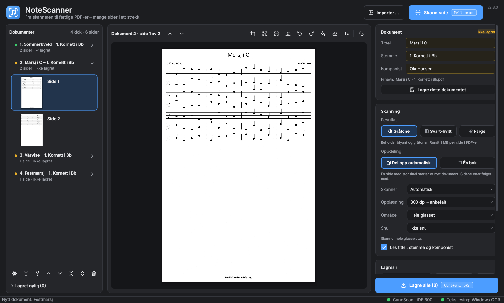

# NoteScanner

**Skann musikknoter til PDF – mange sider i ett strekk.** NoteScanner retter opp, beskjærer og forbedrer hver side
automatisk, leser tittel, stemme og komponist, og deler en bunke skannede ark (eller en hel notebok) i riktige
dokumenter med bokmerker. For Windows 10/11.



*English: NoteScanner scans sheet music to PDF in one keystroke. It deskews, crops and enhances each page, reads
title, part and composer, and splits large batches or whole songbooks into documents with bookmarks. The user
interface is in Norwegian.*

## Last ned

Gå til **[Releases](https://github.com/elha25/NoteScanner/releases/latest)** og last ned
`NoteScanner-Setup-x.y.z.exe`. Dobbeltklikk – den installeres for din bruker uten administrator-tilgang.

Windows kan vise «Windows beskyttet PC-en» første gang (programmet er ikke kodesignert): trykk **Mer info → Kjør
likevel**. Appen ser selv etter nye versjoner og oppdaterer seg med ett klikk.

## Dette gjør den

- **Skann med mellomromstasten** eller knappen på skanneren. Fungerer med skannere som har en Windows-driver (WIA),
  f.eks. Canon CanoScan LiDE 300 og Brother DCP-L2627DW. Velg skanner, oppløsning og skanneområde (A5 = raskere).
- **Automatisk opprydding:** retter opp skjeve sider, beskjærer til notene med jevn marg, fjerner skygge fra
  bokryggen og striper av nabosiden, og gjør papiret hvitt og blekket svart (gråtone, svart-hvitt eller farge).
- **Leser tittelfeltet** med Windows' innebygde tekstgjenkjenning: «MARCH—BEYOND THE BLUE» blir
  *March - Beyond the Blue*, stemme og komponist fylles ut.
- **Deler opp bunken:** ny tittel = nytt dokument. Eller *Én bok*: alt i én PDF med bokmerke per sang. To korte
  sanger på samme bokside blir to sider.
- **Rask kontroll:** lista til venstre viser alle sider; beskjær med musa, roter, angre, lim sammen, skann en side
  på nytt. Lagrede stykker flyttes til «Lagret nylig» i 14 dager.
- **Ingenting går tapt:** økta lagres hele tiden og hentes fram igjen neste gang.

Se [LES_MEG.md](LES_MEG.md) for brukerveiledning og hurtigtaster.

## Skannerknappen

- **Canon og andre WIA-skannere:** *Flere valg → Koble skannerknappen til NoteScanner*, og velg NoteScanner for
  knappen under *Skanneregenskaper → Hendelser*.
- **Brother:** knappen går til Brother iPrint&Scan. La den lagre bildene i en mappe, og velg samme mappe under
  *Flere valg → Overvåk mappe*. Se LES_MEG.md.

## Fant du en feil?

*Flere valg → Rapporter feil* åpner en ferdig utfylt sak her på GitHub (versjon og logg, uten personlige
mappenavn). Ikke legg ved bilder av noter du ikke har rett til å dele – sakene er offentlige.

## Kjøre fra kildekoden

Krever Python 3.11–3.13 på Windows.

```bat
git clone https://github.com/elha25/NoteScanner.git
cd NoteScanner
start.bat
```

`start.bat` installerer pakkene første gang. Tester: `pip install -r requirements-dev.txt` og `python -m pytest`.
Bygg installasjonsfil: se `.github/workflows/release.yml` (PyInstaller + Inno Setup). En ny versjon publiseres
ved å oppdatere `notescanner/__init__.py` og `CHANGELOG.md` på `main` og trykke *Run workflow* under
*Actions → Ny versjon* (eller pushe en tag `vX.Y.Z`).

## Lisens

MIT – se [LICENSE](LICENSE). Tredjepartsbibliotekene og lisensene deres står i
[THIRD_PARTY_NOTICES.md](THIRD_PARTY_NOTICES.md).
